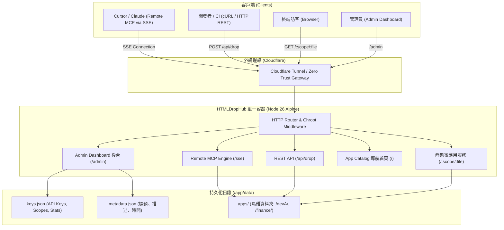

# 🚀 HTMLDropHub

> **AI 時代的輕量微應用（Micro-App）託管平台與雲端 MCP 發布引擎**

[](https://nodejs.org/)
[](https://www.docker.com/)
[](https://modelcontextprotocol.io/)
[](LICENSE)

現代開發者頻繁使用 AI（Cursor、Claude、ChatGPT、Antigravity）生成大量的「單檔 HTML 微應用」或「輕量小工具」。
**HTMLDropHub** 解決了傳統 PaaS 太重、靜態畫布無權限隔離、以及手動複製檔案繁瑣的痛點。

---

## 🌟 核心特色

1. **極致輕量與零伺服器負載**：
   - 專為單檔純前端 HTML 設計，運算 100% 在訪客瀏覽器端執行，對主機硬體與 CPU 零壓力。
2. **雲端 Remote MCP (SSE) 直連發布**：
   - 無需在本機維護繁瑣腳本，Cursor 或 Claude 只要配置雲端 URL 與專屬 Token，即可透過 Tool Call 直接將生成的 HTML 派發上線。
3. **Chroot 權限隔離（Jail 邊界防護）**：
   - 每個 API Key 強制鎖定在指定目錄（例如 `/apps/devA/`）。
   - 具備嚴格的路徑安全校驗（Path Traversal Guard），全面阻斷 `../`、`..\\`、隱藏檔與危險字元，確保多開發者完全互不干擾。
4. **管理員系統 (Admin Dashboard)**：
   - 內建 `/admin` 後台，支援密碼登入或 Cloudflare Zero Trust 標頭認證。
   - 一鍵生成並複製 Cursor、Claude Desktop 與 cURL 的 MCP 連線配置。
5. **自動微應用導航目錄 (App Catalog)**：
   - 根目錄 `/` 自動以現代 Tailwind 卡片呈現已發布工具，支援即時搜尋、分類篩選與**沙盒內嵌預覽 (Live Sandbox Modal)**。
6. **單一 Docker 容器與 Cloudflare Tunnel 整合**：
   - 體積約 100MB，一鍵使用 Docker Compose 啟動，支援 Volume 資料持久化與 Cloudflare 免開 Port 外網穿透。

---

## 🏗️ 系統架構圖



---

## ⚡ 快速開始 (Quick Start)

### 方法一：使用 Docker Compose（推薦生產部署）

1. **複製設定檔**：
   ```bash
   git clone https://github.com/your-username/HTMLDropHub.git
   cd HTMLDropHub
   cp .env.example .env
   ```
2. **編輯 `.env`**：
   ```env
   PORT=3000
   PUBLIC_BASE_URL=https://tools.poiu124.cyou
   ADMIN_PASSWORD=your_secure_password
   ```
3. **啟動容器**：
   ```bash
   docker compose up -d
   ```
4. **訪問服務**：
   - App Catalog 首頁：`http://localhost:3000/`
   - 管理員後台：`http://localhost:3000/admin` (使用設定的密碼登入)

---

### 方法二：本機 Node.js 直接運行

1. **環境需求**：Node.js 20+（推薦 Node.js 26）
2. **安裝與啟動**：
   ```bash
   npm install
   npm start
   ```
3. **執行自動化測試**：
   ```bash
   npm test
   ```

---

## 🤖 AI 客戶端連線配置 (Remote MCP)

### 1. Cursor IDE 配置
1. 開啟 Cursor 設定：**Cursor Settings** &rarr; **Features** &rarr; **MCP**。
2. 點擊 **"Add New MCP Server"**：
   - **Type**: `SSE`
   - **Name**: `HTMLDropHub`
   - **Server URL**: `https://tools.poiu124.cyou/sse?token=hdh_sec_xxxxxx`
3. 在 Cursor Chat 中提問：
   > *"幫我寫一個互動式財務計算小工具，並使用 drop_html 工具發布為單檔 HTML。"*

### 2. Claude Desktop 配置
在 `claude_desktop_config.json` 中加入：
```json
{
  "mcpServers": {
    "htmldrophub": {
      "url": "https://tools.poiu124.cyou/sse?token=hdh_sec_xxxxxx"
    }
  }
}
```

### 3. cURL 直接發布 (CLI / CI/CD)
```bash
curl -X POST "https://tools.poiu124.cyou/api/drop" \
  -H "Authorization: Bearer hdh_sec_xxxxxx" \
  -H "Content-Type: application/json" \
  -d '{
    "filename": "roi-calc.html",
    "title": "ROI Calculator",
    "description": "Calculates project return on investment",
    "content": "<!DOCTYPE html><html><head><title>ROI Calculator</title></head><body><h1>ROI Calc</h1></body></html>"
  }'
```

---

## 🛡️ 安全防護與 Chroot 隔離機制

| 攻擊手法 | HTMLDropHub 防禦策略 |
| :--- | :--- |
| **路徑穿越 (`../../etc/passwd`)** | `resolveSafePath` 強制將路徑限定在 `apps/<scope>/`，任何超出目錄邊界的解析一律拋出 403 Forbidden。 |
| **危險副檔名 (`.exe`, `.sh`, `.php`)** | 僅允許 `.html` 與 `.htm`，副檔名白名單嚴格過濾。 |
| **隱藏檔與點檔案 (`.env`, `.git`)** | 阻絕任何以 `.` 開頭的檔名。 |
| **檔案大小超額衝擊** | 每個 API Key 可限制單檔大小上限（預設 15MB），超額拒絕寫入。 |
| **防止惡意覆蓋** | 可於 API Key 開關 `allowOverwrite: false`，保護既有微應用。 |

---

## ☁️ Cloudflare Tunnel 與 Zero Trust 設定建議

為了達到主機完全對外**免開實體 Port**，可搭配 Cloudflare Tunnel：

1. 在 [Cloudflare Zero Trust 控制台](https://one.dash.cloudflare.com/) 建立 Tunnel。
2. 將 `TUNNEL_TOKEN` 填入 `.env`，並取消 `docker-compose.yml` 中 `tunnel` 服務的註釋。
3. 在 Cloudflare Public Hostname 指向：
   - **Service**: `http://htmldrophub:3000`
4. 於 Cloudflare Access 設定存取規則：
   - `/admin`：要求同仁 Email 驗證（驗證成功後系統會自動辨識 `Cf-Access-Authenticated-User-Email` 登入）。
   - `/sse*` 與 `/messages*`：設定 Bypass 或允許攜帶 Token 連線。

---

## 📄 License
MIT License.
