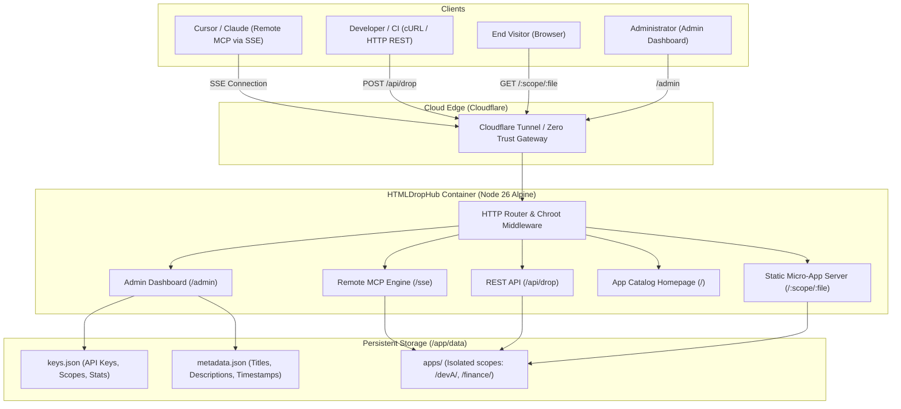

# 🚀 HTMLDropHub

> **Lightweight Single-File Micro-App Hosting Platform & Cloud Remote MCP Publishing Engine for the AI Era**

[](https://nodejs.org/)
[](https://www.docker.com/)
[](https://modelcontextprotocol.io/)
[](LICENSE)

Modern developers frequently leverage AI assistants (Cursor, Claude, ChatGPT, Antigravity) to produce extensive collections of "single-file HTML micro-apps" and "lightweight web utilities".
**HTMLDropHub** solves the headaches of heavy traditional PaaS platforms, unisolated static sandboxes, and tedious manual file copying.

---

## 🌟 Core Features

1. **Ultra-Lightweight & Zero Server Load**:
   - Tailored specifically for standalone frontend HTML files. Execution occurs 100% within the client's browser, posing zero load on server CPU and memory.
2. **Cloud Remote MCP (SSE) Direct Publishing**:
   - No need to maintain complex local scripts. Simply configure Cursor or Claude with your remote URL and dedicated Token to deploy generated HTML directly via tool calls.
3. **Chroot Permission Isolation (Jail Boundary Protection)**:
   - Every API Key is strictly jailed to its designated scope directory (e.g., `/apps/devA/`).
   - Hardened with a Path Traversal Guard blocking `../`, `..\`, dotfiles, and dangerous characters to guarantee multi-tenant security.
4. **Admin Dashboard**:
   - Built-in `/admin` dashboard supporting password sign-in or Cloudflare Zero Trust header authentication.
   - One-click snippet generation and copying for Cursor, Claude Desktop, and cURL MCP integrations.
5. **Automated Micro-App Catalog**:
   - The root `/` automatically displays modern Tailwind cards for all deployed tools, supporting instant keyword search, scope filtering, and **Live Sandbox Modal previews**.
6. **Single Docker Container & Cloudflare Tunnel Integration**:
   - Small footprint (~100MB), instant startup with Docker Compose, volume persistence, and zero-open-port public exposure via Cloudflare Tunnel.

---

## 🏗️ System Architecture



---

## ⚡ Quick Start

### Method 1: Using Docker Compose (Recommended for Production)

1. **Clone Repository & Prepare Environment**:
   ```bash
   git clone https://github.com/your-username/HTMLDropHub.git
   cd HTMLDropHub
   cp .env.example .env
   ```
2. **Configure `.env`**:
   ```env
   PORT=3000
   PUBLIC_BASE_URL=https://tools.poiu124.cyou
   ADMIN_PASSWORD=your_secure_password
   ```
3. **Start the Container**:
   ```bash
   docker compose up -d
   ```
4. **Access the Service**:
   - App Catalog Homepage: `http://localhost:3000/`
   - Admin Dashboard: `http://localhost:3000/admin` (Sign in with your configured admin password)

---

### Method 2: Running Directly with Local Node.js

1. **Prerequisites**: Node.js 20+ (Node.js 26 recommended)
2. **Install & Start**:
   ```bash
   npm install
   npm start
   ```
3. **Run Automated Test Suite**:
   ```bash
   npm test
   ```

---

## 🤖 AI Client Setup (Remote MCP)

### 1. Cursor IDE Setup
1. Open Cursor Settings: **Cursor Settings** &rarr; **Features** &rarr; **MCP**.
2. Click **"Add New MCP Server"**:
   - **Type**: `SSE`
   - **Name**: `HTMLDropHub`
   - **Server URL**: `https://tools.poiu124.cyou/sse?token=hdh_sec_xxxxxx`
3. Prompt Cursor in Chat:
   > *"Write an interactive financial calculator and deploy it as a single-file HTML micro-app using the drop_html tool."*

### 2. Claude Desktop Setup
Add the server entry to your `claude_desktop_config.json`:
```json
{
  "mcpServers": {
    "htmldrophub": {
      "url": "https://tools.poiu124.cyou/sse?token=hdh_sec_xxxxxx"
    }
  }
}
```

### 3. Direct cURL Deployment (CLI / CI/CD)
```bash
curl -X POST "https://tools.poiu124.cyou/api/drop" \
  -H "Authorization: Bearer hdh_sec_xxxxxx" \
  -H "Content-Type: application/json" \
  -d '{
    "filename": "roi-calc.html",
    "title": "ROI Calculator",
    "description": "Calculates project return on investment",
    "content": "<!DOCTYPE html><html><head><title>ROI Calculator</title></head><body><h1>ROI Calc</h1></body></html>"
  }'
```

---

## 🛡️ Security & Chroot Isolation Mechanism

| Attack Vector | HTMLDropHub Defense Strategy |
| :--- | :--- |
| **Path Traversal (`../../etc/passwd`)** | `resolveSafePath` strictly imprisons all file targets inside `apps/<scope>/`. Resolving outside the jail throws 403 Forbidden. |
| **Dangerous Extensions (`.exe`, `.sh`, `.php`)** | Only `.html` and `.htm` files are accepted through a strict extension whitelist. |
| **Hidden & Dotfiles (`.env`, `.git`)** | Rejects any filename starting with a dot (`.`). |
| **File Flooding & Memory Exhaustion** | Enforces maximum upload sizes per API Key (default 15MB); oversized files are blocked before storage. |
| **Accidental Overwrites** | Supports `allowOverwrite: false` per key to preserve existing production micro-apps. |

---

## ☁️ Cloudflare Tunnel & Zero Trust Setup

To operate securely with **zero public inbound open ports**, deploy alongside Cloudflare Tunnel:

1. Create a tunnel in the [Cloudflare Zero Trust Dashboard](https://one.dash.cloudflare.com/).
2. Set your `TUNNEL_TOKEN` in `.env`, and uncomment the `tunnel` service block in `docker-compose.yml`.
3. Point your Cloudflare Public Hostname to:
   - **Service**: `http://htmldrophub:3000`
4. Set Access Policies:
   - `/admin`: Require email verification (the engine recognizes the `Cf-Access-Authenticated-User-Email` header automatically).
   - `/sse*` and `/messages*`: Set to Bypass or allow Bearer/Token header pass-through.

---

## 📄 License
MIT License.
