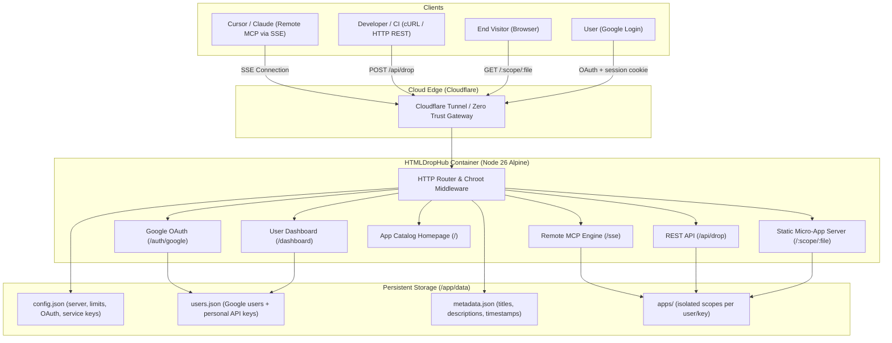

# 🚀 HTMLDropHub

> **Lightweight Single-File Micro-App Hosting Platform & Cloud Remote MCP Publishing Engine for the AI Era**

[](https://nodejs.org/)
[](https://www.docker.com/)
[](https://modelcontextprotocol.io/)
[](LICENSE)

Modern developers frequently leverage AI assistants (Cursor, Claude, ChatGPT, Antigravity) to produce extensive collections of "single-file HTML micro-apps" and "lightweight web utilities".
**HTMLDropHub** solves the headaches of heavy traditional PaaS platforms, unisolated static sandboxes, and tedious manual file copying.

---

## 🌟 Core Features

1. **Ultra-Lightweight & Zero Server Load**:
   - Tailored specifically for standalone frontend HTML files. Execution occurs 100% within the client's browser, posing zero load on server CPU and memory.
2. **Google Login & Multi-User API Keys**:
   - Users sign in with Google, receive a personal jailed scope, and manage their own MCP/REST API keys at `/dashboard`.
   - `users.maxApiKeysPerUser` caps how many API keys each user may create.
3. **File-Based Configuration (No Admin UI)**:
   - One JSON file controls the server, upload limits, Google OAuth, and global service keys.
   - No database and no admin dashboard. Edit the file and restart.
4. **Cloud Remote MCP (SSE) Direct Publishing**:
   - Configure Cursor or Claude with a remote URL and token to deploy generated HTML directly via tool calls.
5. **Chroot Permission Isolation (Jail Boundary Protection)**:
   - Every API Key is strictly jailed to its designated scope directory (e.g., `/apps/devA/`).
   - Hardened with a path traversal guard blocking `../`, `..\`, dotfiles, and dangerous characters.
6. **Configurable Upload Limits**:
   - Allowed file extensions, single-file size, per-folder total size, and per-folder file count are all enforced before writing.
7. **Automated Micro-App Catalog**:
   - The root `/` displays modern Tailwind cards for all deployed tools, with keyword search, scope filtering, and live sandbox previews.
8. **Single Docker Container & Cloudflare Tunnel Integration**:
   - Small footprint, instant startup with Docker Compose, volume persistence, and zero-open-port public exposure via Cloudflare Tunnel.

---

## 🏗️ System Architecture



---

## ⚡ Quick Start

### Method 1: Using Docker Compose (Recommended for Production)

1. **Clone Repository & Prepare Environment**:
   ```bash
   git clone https://github.com/your-username/HTMLDropHub.git
   cd HTMLDropHub
   cp .env.example .env
   ```
2. **Start the Container**:
   ```bash
   docker compose up -d
   ```
3. **Get the Generated API Key**:
   - On first launch, `data/config.json` is created automatically with a generated API key.
   - The token is printed in the container logs:
     ```bash
     docker compose logs htmldrophub | grep "Generated API key"
     ```
4. **Access the Service**:
   - App Catalog Homepage: `http://localhost:3000/`
   - Edit `data/config.json` to change the public URL, limits, OAuth settings, and service keys, then restart the container.

### Configure Google Login

Multi-user login requires a Google OAuth client:

1. Open [Google Cloud Console → Credentials](https://console.cloud.google.com/apis/credentials).
2. Create an **OAuth client ID** of type **Web application**.
3. Add an authorized redirect URI:
   - Local: `http://localhost:3000/auth/google/callback`
   - Production: `https://your-domain.example/auth/google/callback`
4. Put the credentials in `data/config.json`:
   ```json
   {
     "auth": {
       "google": {
         "clientId": "xxxx.apps.googleusercontent.com",
         "clientSecret": "xxxx",
         "redirectUri": "https://your-domain.example/auth/google/callback",
         "allowedEmailDomains": []
       }
     }
   }
   ```
5. Restart the service and open `/dashboard` (or click **Sign in** on the catalog).

`allowedEmailDomains` is optional. Leave it empty to allow every Google account, or set e.g. `["example.com"]` to restrict access.

---

### Method 2: Running Directly with Local Node.js

1. **Prerequisites**: Node.js 20+ (Node.js 26 recommended)
2. **Install & Start**:
   ```bash
   npm install
   npm start
   ```
3. **Run Automated Test Suite**:
   ```bash
   npm test
   ```

On first launch, `data/config.json` is generated with a random API key for the `demo` scope. Look for the `Generated API key` line in the console output.

---

## ⚙️ Configuration

All global settings live in **one JSON file**:

```
data/config.json
```

You can point to a different file with the `CONFIG_FILE` environment variable:

```bash
CONFIG_FILE=./my-config.json npm start
```

> The file is created automatically on first launch. Restart the service after editing it.
> If a legacy `data/keys.json` exists when the config file is first created, its API keys are imported automatically.

### Full Example

```json
{
  "server": {
    "port": 3000,
    "publicBaseUrl": "https://tools.example.com",
    "trustProxy": true,
    "allowPublicCatalog": true
  },
  "limits": {
    "allowedExtensions": [".html", ".htm"],
    "maxFileSizeMb": 15,
    "maxScopeSizeMb": 200,
    "maxScopeFileCount": 100
  },
  "defaults": {
    "allowOverwrite": true
  },
  "users": {
    "maxApiKeysPerUser": 5
  },
  "auth": {
    "sessionSecret": "",
    "google": {
      "clientId": "xxxx.apps.googleusercontent.com",
      "clientSecret": "xxxx",
      "redirectUri": "https://tools.example.com/auth/google/callback",
      "allowedEmailDomains": []
    }
  },
  "apiKeys": [
    {
      "name": "Default_Developer",
      "token": "hdh_sec_replace_this_with_a_long_random_token",
      "scope": "demo",
      "enabled": true,
      "allowOverwrite": true
    }
  ]
}
```

### `server`

| Field | Type | Description |
| :--- | :--- | :--- |
| `port` | number | HTTP listening port. |
| `publicBaseUrl` | string | Public base URL used in generated app links and MCP responses. No trailing slash needed. |
| `trustProxy` | boolean | Trust `X-Forwarded-*` headers (enable behind Cloudflare Tunnel / reverse proxy). |
| `allowPublicCatalog` | boolean | When `false`, `/` returns 403. Deployed app files are still served normally. |

### `limits`

| Field | Type | Description |
| :--- | :--- | :--- |
| `allowedExtensions` | string[] | Allowed filename extensions (case-insensitive). Example: `[".html", ".htm"]`. |
| `maxFileSizeMb` | number | Maximum size of a single uploaded file, in MB. This is a hard global cap. |
| `maxScopeSizeMb` | number | Maximum total size of all files in one scope folder, in MB. |
| `maxScopeFileCount` | number | Maximum number of files in one scope folder. |

Limit rules:

- Limits are enforced **before** the file is written.
- Updating an existing file does not consume an extra file-count slot.
- When updating, the old file size is subtracted before checking the folder total.
- A per-key `maxFileSizeMb` may be added to `apiKeys`, but it can only be **lower** than the global `limits.maxFileSizeMb`.

### `defaults`

| Field | Type | Description |
| :--- | :--- | :--- |
| `allowOverwrite` | boolean | Default overwrite behavior for keys that do not specify their own `allowOverwrite`. |

### `users`

| Field | Type | Description |
| :--- | :--- | :--- |
| `maxApiKeysPerUser` | number | Maximum number of API keys each Google-authenticated user may create. Set to `0` to disable user key creation. Default: `5`. |

### `auth`

| Field | Type | Description |
| :--- | :--- | :--- |
| `sessionSecret` | string | Secret used to sign session cookies. Leave empty to auto-generate and persist `data/session-secret`. |
| `auth.google.clientId` | string | Google OAuth client ID. |
| `auth.google.clientSecret` | string | Google OAuth client secret. |
| `auth.google.redirectUri` | string | OAuth callback URL. Must exactly match the Google Console entry. Defaults to `${publicBaseUrl}/auth/google/callback` when empty. |
| `auth.google.allowedEmailDomains` | string[] | Optional email domain allow-list. Empty means any Google account is allowed. |

Google-authenticated users are stored in `data/users.json`. Each user receives a stable personal scope (`u_xxxxxxxxxxxxxxxx/`) and can create up to `users.maxApiKeysPerUser` API keys from `/dashboard`. User-created keys are not written into `config.json`.

### `apiKeys`

`apiKeys` in `config.json` are **global/service keys** that are not tied to a Google user. They are useful for CI or machine-to-machine access. Personal user keys are stored in `data/users.json`.

Each key is bound to exactly one scope folder.

| Field | Type | Required | Description |
| :--- | :--- | :--- | :--- |
| `name` | string | No | Human-readable key name. |
| `token` | string | Yes | Bearer token used by MCP / REST clients. Must be unique. |
| `scope` | string | Yes | Folder name under `data/apps/`. Letters, numbers, `_`, `-` only. |
| `enabled` | boolean | No | Set to `false` to disable the key without deleting it. Default: `true`. |
| `allowOverwrite` | boolean | No | Allow replacing an existing file. Defaults to `defaults.allowOverwrite`. |
| `maxFileSizeMb` | number | No | Per-key file size limit. Cannot exceed the global limit. |
| `notes` | string | No | Free-form notes. |

Generate a strong token with:

```bash
node -e "console.log('hdh_sec_' + require('crypto').randomBytes(20).toString('hex'))"
```

---

## 🤖 AI Client Setup (Remote MCP)

Sign in at `/dashboard` with Google and create a personal API key, or use a global service key from `data/config.json`. Replace `hdh_sec_xxxxxx` below with that token.

### 1. Cursor IDE Setup

1. Open Cursor Settings: **Cursor Settings** &rarr; **Features** &rarr; **MCP**.
2. Click **"Add New MCP Server"**:
   - **Type**: `SSE`
   - **Name**: `HTMLDropHub`
   - **Server URL**: `https://tools.example.com/sse?token=hdh_sec_xxxxxx`
3. Prompt Cursor in Chat:
   > *"Write an interactive financial calculator and deploy it as a single-file HTML micro-app using the drop_html tool."*

### 2. Claude Desktop Setup

Add the server entry to your `claude_desktop_config.json`:

```json
{
  "mcpServers": {
    "htmldrophub": {
      "url": "https://tools.example.com/sse?token=hdh_sec_xxxxxx"
    }
  }
}
```

### 3. Direct cURL Deployment (CLI / CI/CD)

```bash
curl -X POST "https://tools.example.com/api/drop" \
  -H "Authorization: Bearer hdh_sec_xxxxxx" \
  -H "Content-Type: application/json" \
  -d '{
    "filename": "roi-calc.html",
    "title": "ROI Calculator",
    "description": "Calculates project return on investment",
    "content": "<!DOCTYPE html><html><head><title>ROI Calculator</title></head><body><h1>ROI Calc</h1></body></html>"
  }'
```

### MCP Tools

| Tool | Description |
| :--- | :--- |
| `drop_html` | Deploy or update a single-file HTML micro-app. |
| `list_my_apps` | List apps in the key's scope. |
| `delete_my_app` | Delete an app from the key's scope. |
| `get_my_info` | Show key name, scope, limits, and public base URL. |

---

## 🔌 HTTP API

| Method | Endpoint | Auth | Description |
| :--- | :--- | :--- | :--- |
| `GET` | `/health` | No | Health check. |
| `GET` | `/auth/google` | No | Start Google OAuth login. |
| `GET` | `/auth/google/callback` | No | Google OAuth callback. Sets a signed session cookie. |
| `POST` | `/auth/logout` | Session | Clear the user session. |
| `GET` | `/dashboard` | Google session | User dashboard for managing personal API keys. |
| `GET` | `/api/session` | Optional | Return the current signed-in user, if any. |
| `GET` | `/api/me` | Google session | Current user profile, key count, and personal API keys. |
| `POST` | `/api/me/keys` | Google session | Create a personal API key (enforces `users.maxApiKeysPerUser`). |
| `DELETE` | `/api/me/keys/:id` | Google session | Delete one of the current user's API keys. |
| `POST` | `/api/drop` | Bearer token | Deploy or update an app. Accepts JSON or raw HTML with `X-Filename`. |
| `GET` | `/api/apps` | Optional | List apps. With a token, only that key's scope is returned. |
| `DELETE` | `/api/apps/:filename` | Bearer token | Delete an app in the key's scope. |
| `GET` | `/sse?token=...` | Token | Remote MCP SSE connection. |
| `POST` | `/messages?sessionId=...` | Session | MCP message endpoint. |
| `GET` | `/:scope/:filename` | No | Serve a deployed micro-app. |

---

## 🛡️ Security & Limit Enforcement

| Attack / Abuse Vector | HTMLDropHub Defense Strategy |
| :--- | :--- |
| **Path Traversal (`../../etc/passwd`)** | `resolveSafePath` strictly imprisons all file targets inside `apps/<scope>/`. Resolving outside the jail throws 403 Forbidden. |
| **Dangerous Extensions (`.exe`, `.sh`, `.php`)** | Only the extensions listed in `limits.allowedExtensions` are accepted. |
| **Hidden & Dotfiles (`.env`, `.git`)** | Rejects any filename starting with a dot (`.`). |
| **Single-File Flooding** | `limits.maxFileSizeMb` blocks oversized uploads before storage. |
| **Folder Flooding** | `limits.maxScopeFileCount` caps the number of files in a scope. |
| **Disk Exhaustion** | `limits.maxScopeSizeMb` caps the total size of each scope folder. |
| **Accidental Overwrites** | Supports `allowOverwrite: false` per key to preserve existing production micro-apps. |
| **API Key Sprawl** | `users.maxApiKeysPerUser` limits how many keys each Google user can create. |
| **OAuth CSRF / Session Forgery** | OAuth `state` is validated, and session cookies are HMAC-signed, `HttpOnly`, and `SameSite=Lax`. |
| **Unauthorized Email Domains** | Optional `auth.google.allowedEmailDomains` allow-list. |
| **Cross-User Access** | Each Google user receives an immutable personal scope; dashboard APIs only operate on `req.user`'s own keys. |

---

## ☁️ Cloudflare Tunnel & Zero Trust Setup

To operate securely with **zero public inbound open ports**, deploy alongside Cloudflare Tunnel:

1. Create a tunnel in the [Cloudflare Zero Trust Dashboard](https://one.dash.cloudflare.com/).
2. Set your `TUNNEL_TOKEN` in `.env`, and uncomment the `tunnel` service block in `docker-compose.yml`.
3. Point your Cloudflare Public Hostname to:
   - **Service**: `http://htmldrophub:3000`
4. Set Access Policies:
   - `/auth/google*` and `/auth/google/callback`: Public (users must be able to reach Google OAuth).
   - `/dashboard`, `/api/session`, `/api/me*`: Public at the Cloudflare level; HTMLDropHub enforces Google sessions itself.
   - `/sse*` and `/messages*`: Set to Bypass or allow Bearer/Token header pass-through.
   - `/:scope/:file`: Public access (or protect with your own Access policy).

---

## 📄 License

MIT License.
